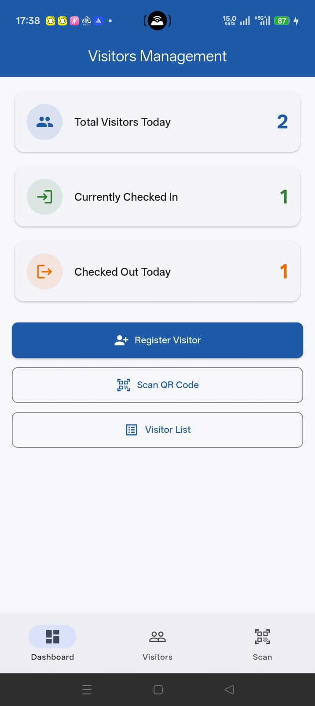
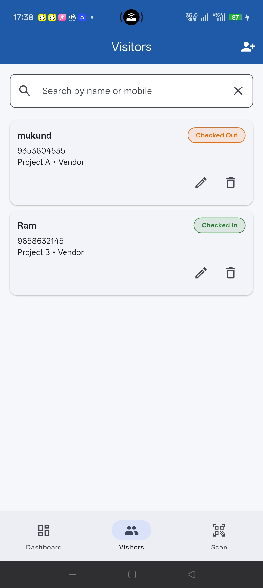
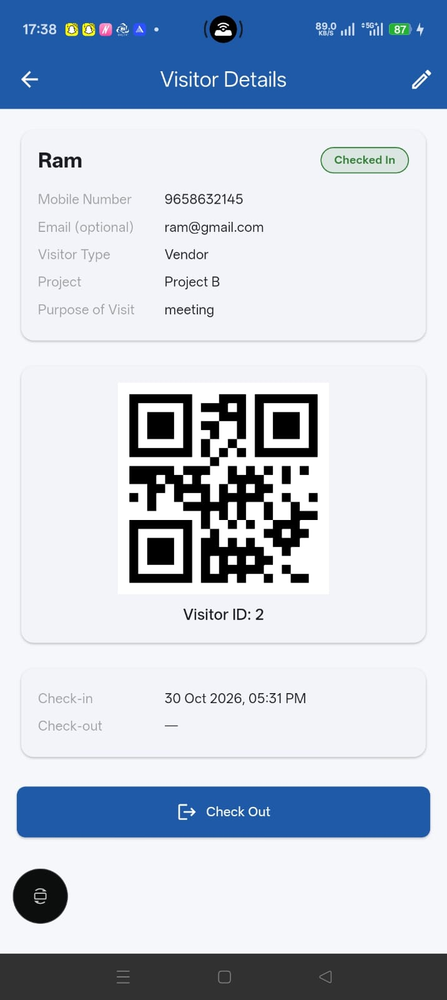

# Visitor Management App

A Flutter app for registering visitors, generating QR passes, and tracking check-in and check-out.

## Features

- Dashboard with today's visitor stats
- Register, edit, and delete visitors
- Search visitors by name or mobile number
- QR code for each visitor
- QR scanner to look up visitors
- Check-in and check-out tracking

## State Management

- **BLoC** (`flutter_bloc`)

## Architecture

Clean Architecture with three layers:

```
lib/
├── core/           # config, constants, theme, errors
├── data/           # datasources, models, repository impl
├── domain/         # entities, repository contract, use cases
└── presentation/   # bloc, screens, widgets
```

## Run

```bash
flutter pub get
flutter run --dart-define-from-file=config/dev.json
```

## Screenshots

| Dashboard | Visitor List | Visitor Details | QR Scanner |
| :-------: | :----------: | :-------------: | :--------: |
|  |  |  |  |
